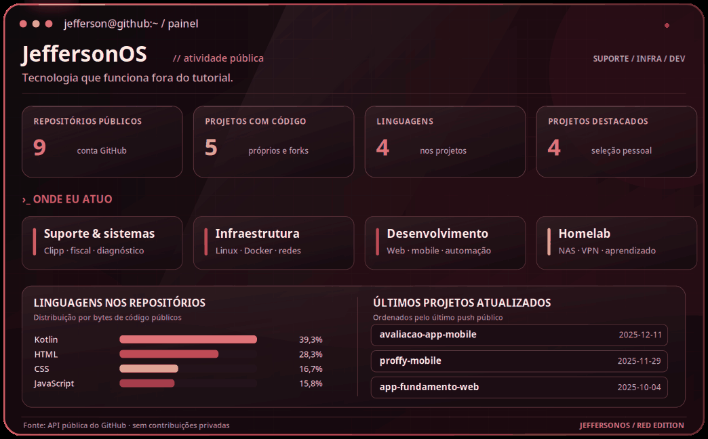

<div align="center">
  

  <br>

  

  **Tecnologia que funciona fora do tutorial.**

  Suporte técnico · Infraestrutura · Desenvolvimento
</div>

Opa, eu sou o **Jefferson**! Trabalho na **BlueTec, parceira da Zucchetti**, no suporte aos sistemas de gestão da linha **Clipp**. Entre implantação, nota fiscal e diagnóstico de erro no cliente, peguei gosto por achar a causa do problema e deixar uma solução que não volte a quebrar na semana seguinte.

Fora do suporte, mexo com Linux, servidores, redes, automação e código. Muita coisa eu testo primeiro no meu homelab, e boa parte do que aprendi veio do que deu errado lá.

<div align="center">
  <code>jefferson@bazzite:~$ ./explorar-perfil</code>
</div>

---

### Painel público

<div align="center">
  
</div>

<sub>Dados dos repositórios públicos, atualizados por GitHub Actions. O gráfico de linguagens mede bytes de código, não nível de conhecimento. [Versão estática em SVG](./assets/dashboard-red.svg).</sub>

---

### Terminal

```text
jefferson@profile:~$ help
/sobre     /projetos     /homelab     /suporte     /stack     /contato
```

<sub>Clique num comando para abrir ou fechar a seção.</sub>

<details>
<summary><strong>➜ ~ /sobre</strong> · um pouco sobre mim</summary>

<br>

Gosto de entender como as coisas funcionam, principalmente quando param de funcionar. O suporte me deixa perto dos problemas reais das pessoas, e Linux, redes e programação me dão outras formas de resolver esses problemas.

Hoje estudo desenvolvimento web, mobile e automação, sem largar infraestrutura e suporte. Aprendo melhor construindo alguma coisa do que juntando ferramenta numa lista.

```text
entender → reproduzir → corrigir → validar → documentar
```

</details>

<details open>
<summary><strong>➜ ~ /projetos</strong> · projetos e repositórios</summary>

<br>

```text
jefferson@profile:~/projetos$ ls
proffy-mobile/   avaliacao-app-mobile/   app-fundamento-web/   primeiro-app-android/
```

| Projeto | O que tem | Acesso |
| :--- | :--- | :--- |
| **proffy-mobile** | App Android em Kotlin. | [Abrir ↗](https://github.com/kisleyj/proffy-mobile) |
| **avaliacao-app-mobile** | App Android com tela de login e autenticação. | [Abrir ↗](https://github.com/kisleyj/avaliacao-app-mobile) |
| **app-fundamento-web** | Site em HTML, CSS e JavaScript. | [Abrir ↗](https://github.com/kisleyj/app-fundamento-web) |
| **primeiro-app-android** | Meus primeiros testes com Android. | [Abrir ↗](https://github.com/kisleyj/primeiro-app-android) |

[Ver todos os repositórios públicos ↗](https://github.com/kisleyj?tab=repositories)

</details>

<details>
<summary><strong>➜ ~ /homelab</strong> · meu laboratório de infraestrutura</summary>

<br>

```text
/home/jefferson/homelab/
├── linux/         Bazzite · MX Linux
├── containers/    Docker · CasaOS
├── redes/         MikroTik · WireGuard · Tailscale
├── servicos/      NAS · n8n · acesso remoto
└── notas/         testar · entender · documentar
```

É meu ambiente de estudo, nada aqui roda em produção. Uso para testar configuração nova e entender o porquê de cada escolha.

</details>

<details>
<summary><strong>➜ ~ /suporte</strong> · experiência profissional</summary>

<br>

Na **BlueTec, parceira da Zucchetti**, trabalho no suporte à linha **Clipp**. No dia a dia faço implantação, configuração e validação fiscal, emissão de documentos eletrônicos, diagnóstico de falhas e atendimento aos clientes.

Isso mudou meu jeito de programar. Primeiro eu diagnostico, depois altero. Explico o que fiz em palavras simples e automatizo o que se repete.

</details>

<details>
<summary><strong>➜ ~ /stack</strong> · tecnologias e ferramentas</summary>

<br>

**Suporte e infraestrutura:** Linux, Docker, NAS, MikroTik, VPN e n8n.  
**Projetos e estudos:** Python, JavaScript, TypeScript, Kotlin, Java, HTML, CSS e MySQL.

</details>

<details>
<summary><strong>➜ ~ /contato</strong> · onde me encontrar</summary>

<br>

Por enquanto, aqui mesmo: **[github.com/kisleyj](https://github.com/kisleyj)**.

</details>

---

### Tecnologias e ferramentas

<div align="center">
  <a href="https://www.kernel.org/" title="Linux"></a>
  <a href="https://www.docker.com/" title="Docker"></a>
  <a href="https://www.python.org/" title="Python"></a>
  <a href="https://developer.mozilla.org/en-US/docs/Web/JavaScript" title="JavaScript"></a>
  <a href="https://www.typescriptlang.org/" title="TypeScript"></a>
  <a href="https://kotlinlang.org/" title="Kotlin"></a>
  <a href="https://dev.java/" title="Java"></a>
  <a href="https://developer.mozilla.org/en-US/docs/Web/HTML" title="HTML"></a>
  <a href="https://developer.mozilla.org/en-US/docs/Web/CSS" title="CSS"></a>
  <a href="https://git-scm.com/" title="Git"></a>
  <a href="https://github.com/" title="GitHub"></a>
  <a href="https://www.mysql.com/" title="MySQL"></a>
</div>

<p align="center">
  <a href="https://mikrotik.com/" title="MikroTik"></a>
  <a href="https://n8n.io/" title="n8n"></a>
  <a href="https://developer.android.com/" title="Android"></a>
</p>

---

<div align="center">
  <sub><code>// keep learning, keep building</code></sub>
</div>
